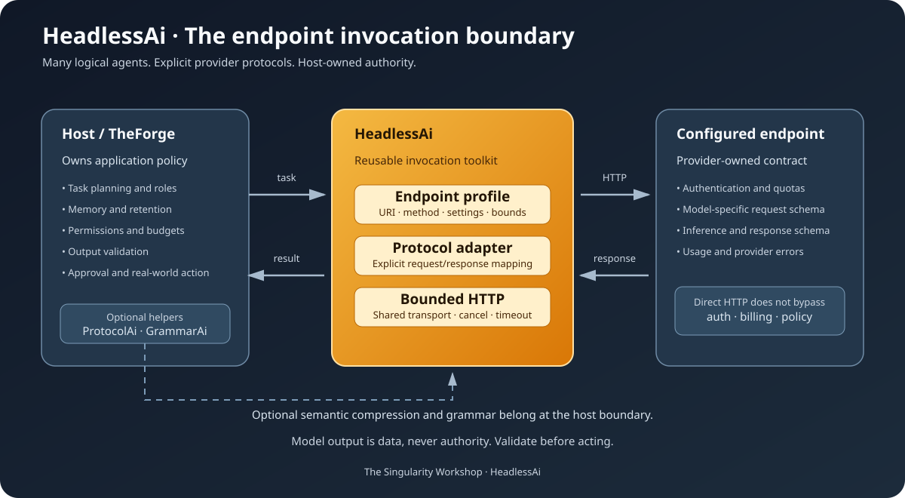
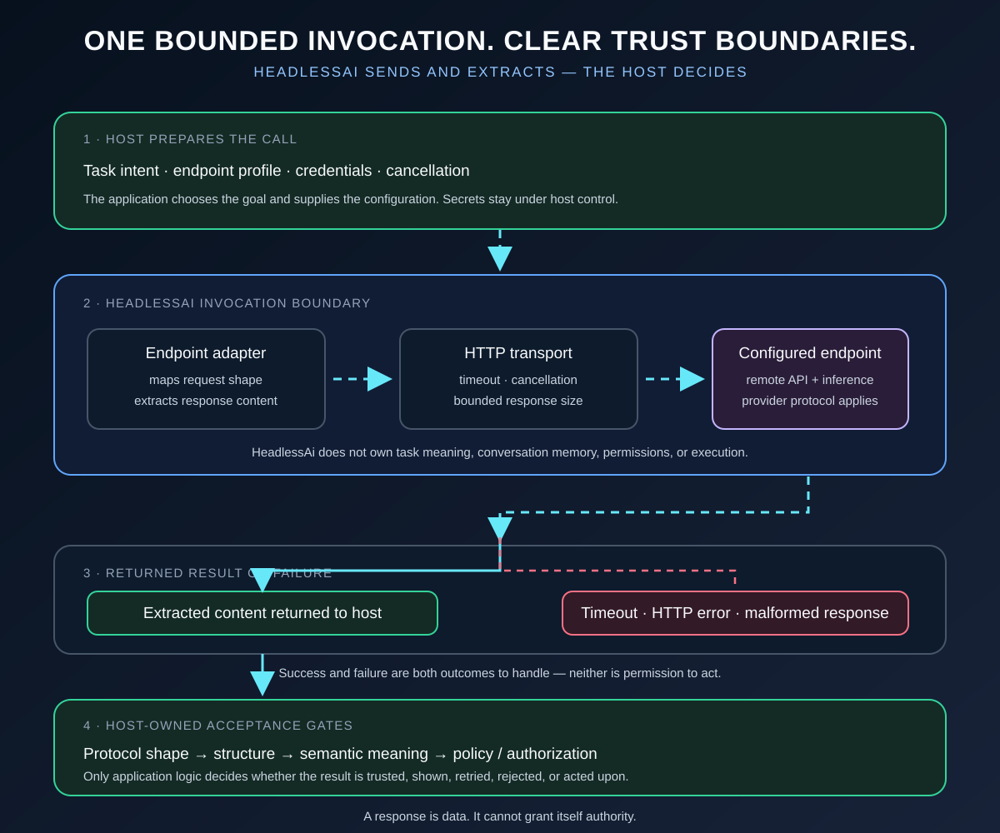

<!-- The Singularity Workshop moniker -->
<p align="center">
  <a href="https://github.com/TrentBest">
    
  </a>
</p>

# HeadlessAi Gallery

HeadlessAi provides provider-neutral HTTP invocation primitives with explicit endpoint-specific adapters. This gallery separates the explanatory architecture picture from deterministic fixtures that verify request mapping and failure behavior.

## Visual tour

### The endpoint invocation boundary



This authored architecture diagram shows the responsibility split: the host owns intent, permissions, memory, and validation; HeadlessAi maps normalized input to an endpoint protocol and bounds the HTTP response; the provider owns its API and inference. ProtocolAi and GrammarAi are optional host-side helpers, not required dependencies of HeadlessAi's core.

The picture is explanatory artwork—not a live request trace, generated UML, or proof that a remote provider was contacted.

### README journey markers

The SVGs in [section-dividers](assets/section-dividers/) are navigation artwork for the six-part README journey, not implementation diagrams.

### Follow one invocation from intent to decision



Read the flow from top to bottom:

1. The host chooses the task, endpoint profile, credentials, cancellation policy, and what the result may be used for.
2. HeadlessAi uses the selected adapter to map the endpoint-specific request and extract response content around a bounded HTTP invocation.
3. A call can return content or fail through timeout, transport/HTTP errors, malformed responses, or configured limits. These outcomes must be handled explicitly.
4. The host applies the checks that determine whether the result is structurally acceptable, semantically appropriate, and authorized for any consequential action.

The animation is an authored conceptual walkthrough, not a live trace or a claim that every endpoint has identical failure semantics. The adapter and endpoint contract determine the concrete request and response details.

## See actual behavior

From the repository root:

```bash
dotnet test tests/TheSingularityWorkshop.HeadlessAi.Tests/TheSingularityWorkshop.HeadlessAi.Tests.csproj --configuration Release
dotnet pack src/TheSingularityWorkshop.HeadlessAi/TheSingularityWorkshop.HeadlessAi.csproj --configuration Release
```

The tests use deterministic HTTP fixtures; they do not require paid live-provider calls. They cover adapter request/response behavior, malformed and empty responses, timeout and response-size boundaries, and invalid settings. A successful fixture test is not proof of compatibility with every provider API variant.

## Detailed recipe

Start with [Usage](usage.md), then read [Provider Adapters](provider-adapters.md), [Provider Failure Contract](provider-failure-contract.md), [Security Model](security.md), [Architecture Boundaries](architecture-boundaries.md), and [Alpha Readiness](ALPHA_READINESS.md).

---

<p align="center">
  <a href="https://github.com/TrentBest">
    
  </a>
</p>

<p align="center">
  <a href="https://github.com/TrentBest">GitHub</a> ·
  <a href="https://coderlegion.com/">Coder Legion</a> ·
  <a href="https://www.patreon.com/c/TheSingularityWorkshop">Patreon</a> ·
  <a href="https://www.paypal.com/donate/?hosted_button_id=3Z7263LCQMV9J">PayPal</a>
  <br>
  <a href="https://github.com/TrentBest/FSM_API">FSM_API</a> ·
  <a href="https://github.com/TrentBest/TheSingularityWorkshop.FSM_Serialization">FSM_Serialization</a> ·
  <a href="https://github.com/TrentBest/WebPage">WebPage</a>
</p>

<p align="center"><em>The Singularity Workshop — Tools for the curious, the bold, and the systemically inclined.</em><br><strong>Because state shouldn't be a mess.</strong><br><em>And because static boundaries are invitations to cause trouble.</em></p>

## Phone-first release review

Start with the [Usage Guide](usage.md) to configure a profile and adapter, send a request, and handle the response. Use [What is HeadlessAi?](WHAT_IS_HEADLESSAI.md) for the core idea and [Architecture Boundaries](architecture-boundaries.md) for the host-owned responsibilities.
