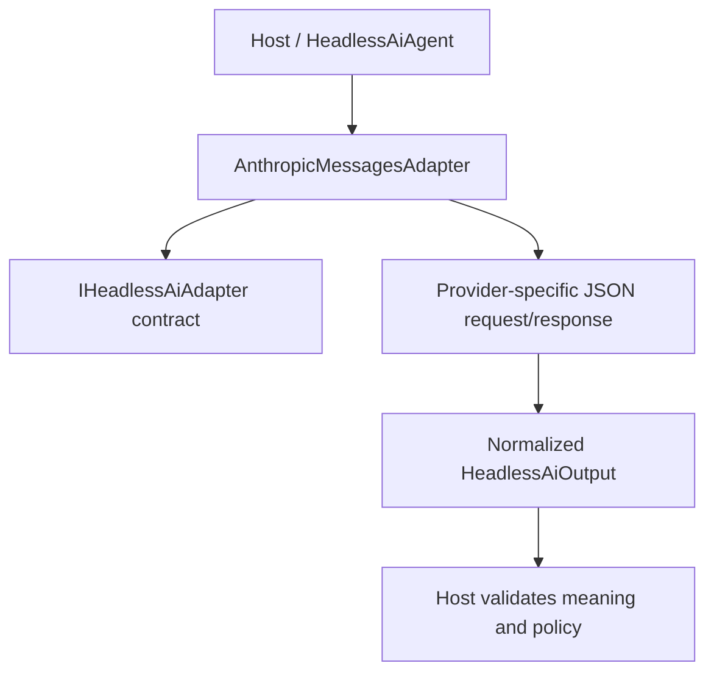

<!-- The Singularity Workshop moniker -->

# AnthropicMessagesAdapter — UML neighborhood and use cases

> **Target:** AnthropicMessagesAdapter. This authored static diagram is source-oriented, not a runtime trace.

## Neighborhood

## Source-backed relationships

- **Target source:** [src/TheSingularityWorkshop.HeadlessAi/AnthropicMessagesAdapter.cs](../../src/TheSingularityWorkshop.HeadlessAi/AnthropicMessagesAdapter.cs).
- **Related types:** IHeadlessAiAdapter; JsonHeadlessAiAdapter; HeadlessAiProfile; HeadlessAiInput; HeadlessAiOutput.
- **Evidence:** [tests/TheSingularityWorkshop.HeadlessAi.Tests/ProviderAdapterTests.cs](../../tests/TheSingularityWorkshop.HeadlessAi.Tests/ProviderAdapterTests.cs).
- **Scope:** authored from named source/test references; not generated from a repository-wide AST or runtime trace.

## Use case — invoke the configured provider protocol

- **Actor:** host application.
- **Goal:** send one bounded request through the provider's HTTP contract.
- **Trigger:** the host sends HeadlessAiInput through a configured HeadlessAiAgent.
- **Preconditions:** profile settings, endpoint, and request-time headers satisfy the selected provider protocol.
- **Outcome:** response content is normalized into the package output contract or a documented failure is raised.
- **Alternative/failure:** invalid/missing settings, malformed response, HTTP failure, timeout, cancellation, or response-bound violation must not be silently treated as a valid answer.
- **Authority boundary:** the host owns credential supply, trust decisions, response validation, authorization, and any consequential action.

## Related pages

- [Type guide](../types/AnthropicMessagesAdapter.md)
- [Provider adapters](../provider-adapters.md)
- [Shared Workshop documentation standard](https://github.com/TrentBest/TheSingularityWorkshop.FSM_COS/blob/development/DOCUMENTATION_STANDARD.md)

---

<!-- THE SINGULARITY WORKSHOP FOOTER -->

