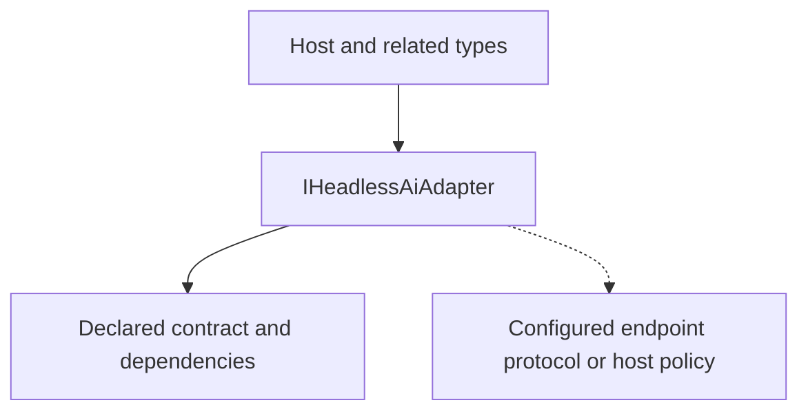

<!-- The Singularity Workshop moniker -->

# IHeadlessAiAdapter — UML neighborhood and use cases

> **Target:** public interface IHeadlessAiAdapter. This static relationship map is authored from current source; it is not a runtime trace or generated UML.

## Neighborhood

## Source-backed relationships

- **Target source:** [src/TheSingularityWorkshop.HeadlessAi/IHeadlessAiAdapter.cs](../../src/TheSingularityWorkshop.HeadlessAi/IHeadlessAiAdapter.cs).
- **Related types:** HeadlessAiAgent; HeadlessAiAgentTemplate; RawTextHeadlessAiAdapter; JsonHeadlessAiAdapter; OpenAiResponsesAdapter; GeminiGenerateContentAdapter; AnthropicMessagesAdapter.
- **Evidence:** current source declaration and [tests/TheSingularityWorkshop.HeadlessAi.Tests/ProviderAdapterTests.cs](../../tests/TheSingularityWorkshop.HeadlessAi.Tests/ProviderAdapterTests.cs).
- **Scope limitation:** no automated repository-wide consumer scan is claimed.

## Use case — bounded endpoint invocation

- **Actor:** host application.
- **Goal:** perform one configured endpoint operation through an explicit protocol contract.
- **Trigger:** the host submits input or configures an invocation.
- **Preconditions:** endpoint/profile and adapter are selected; host transport and request-time credentials are configured as required.
- **Outcome:** normalized response data or a documented failure returns to the host.
- **Alternative/failure:** malformed provider responses, non-success status, timeout, oversized body, or cancellation are handled according to the agent and adapter contract.
- **Authority boundary:** the host validates returned content and decides whether to retry, reject, request approval, or act.
- **Evidence/status:** authored use case grounded in the current API; not inferred automatically from syntax.

## Related pages

- [Type guide](../types/IHeadlessAiAdapter.md)
- [Problem domain](../problem-domain.md)
- [Shared Workshop documentation standard](https://github.com/TrentBest/TheSingularityWorkshop.FSM_COS/blob/development/DOCUMENTATION_STANDARD.md)

---

<!-- THE SINGULARITY WORKSHOP FOOTER -->

