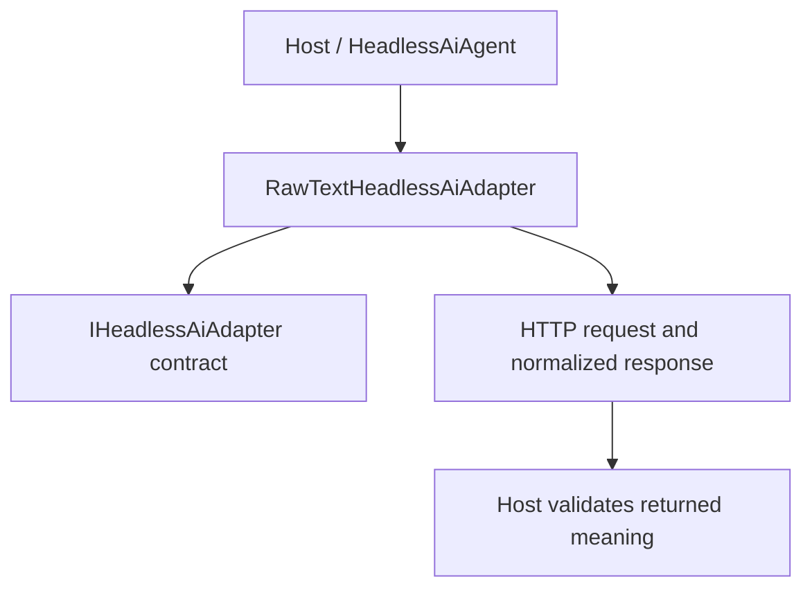

<!-- The Singularity Workshop moniker -->

# RawTextHeadlessAiAdapter — UML neighborhood and use cases

> **Target:** RawTextHeadlessAiAdapter. This authored static diagram reflects source-level relationships and is not a runtime trace.

## Neighborhood

## Source-backed relationships

- **Target source:** [src/TheSingularityWorkshop.HeadlessAi/RawTextHeadlessAiAdapter.cs](../../src/TheSingularityWorkshop.HeadlessAi/RawTextHeadlessAiAdapter.cs).
- **Related types:** IHeadlessAiAdapter; HeadlessAiProfile; HeadlessAiInput; HeadlessAiOutput.
- **Evidence:** [tests/TheSingularityWorkshop.HeadlessAi.Tests/ProviderAdapterTests.cs](../../tests/TheSingularityWorkshop.HeadlessAi.Tests/ProviderAdapterTests.cs).
- **Scope:** authored from named source and test references; not generated from a repository-wide AST or runtime trace.

## Use case — adapt one endpoint protocol

- **Actor:** host application.
- **Goal:** communicate with an endpoint using its declared request and response shape.
- **Trigger:** the host creates a HeadlessAiAgent with a selected adapter and sends an input.
- **Preconditions:** profile settings and endpoint URI match the selected adapter's protocol.
- **Outcome:** the adapter produces an HTTP request and normalizes response content or surfaces a documented failure.
- **Alternative/failure:** invalid settings, malformed response bodies, non-success HTTP status, timeout, or response-bound violations must fail explicitly.
- **Authority boundary:** adapter output is untrusted content; the host owns validation, permissions, approval, and actions.

## Related pages

- [Type guide](../types/RawTextHeadlessAiAdapter.md)
- [Provider adapters](../provider-adapters.md)
- [Shared Workshop documentation standard](https://github.com/TrentBest/TheSingularityWorkshop.FSM_COS/blob/development/DOCUMENTATION_STANDARD.md)

---

<!-- THE SINGULARITY WORKSHOP FOOTER -->

